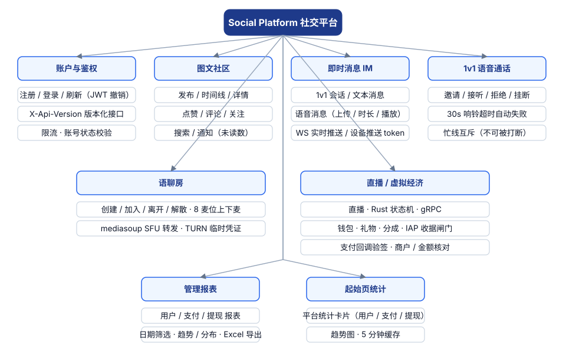
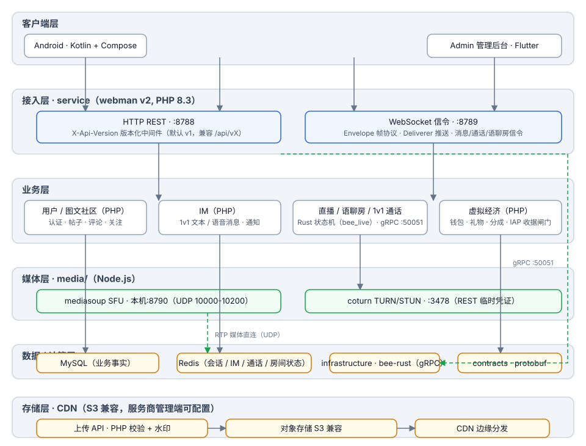
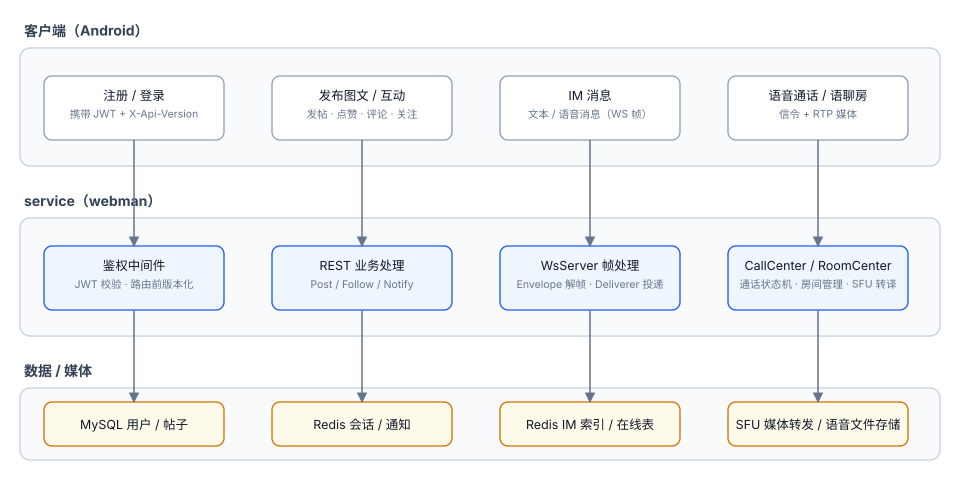
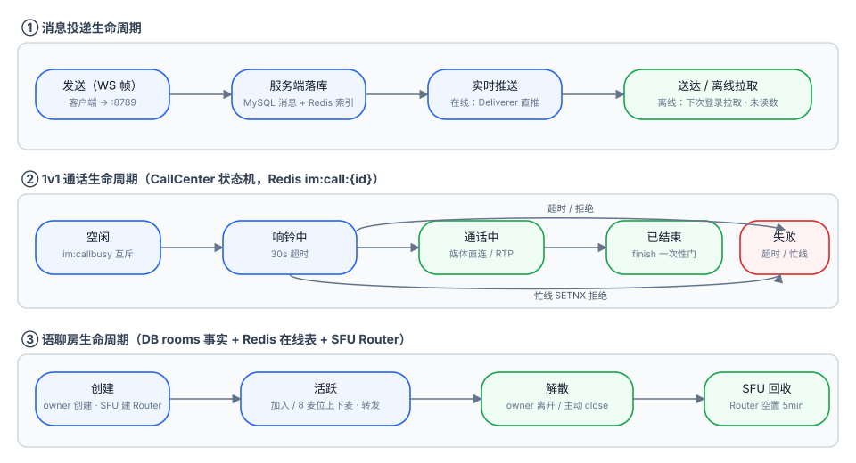
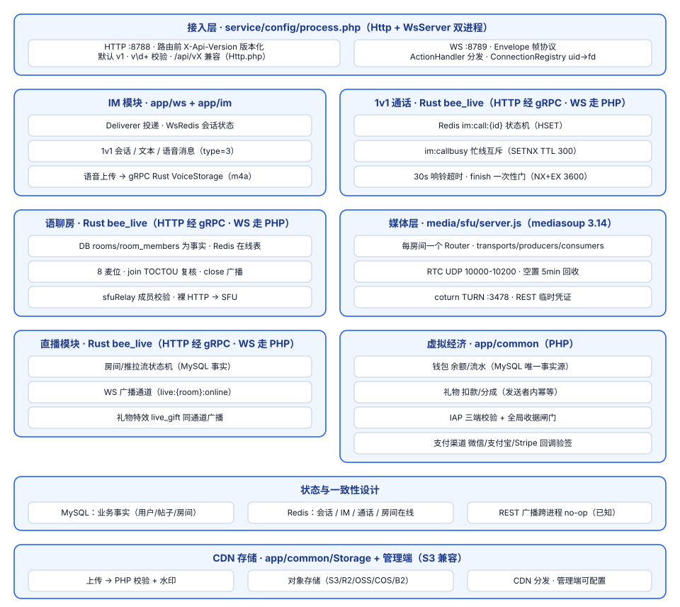
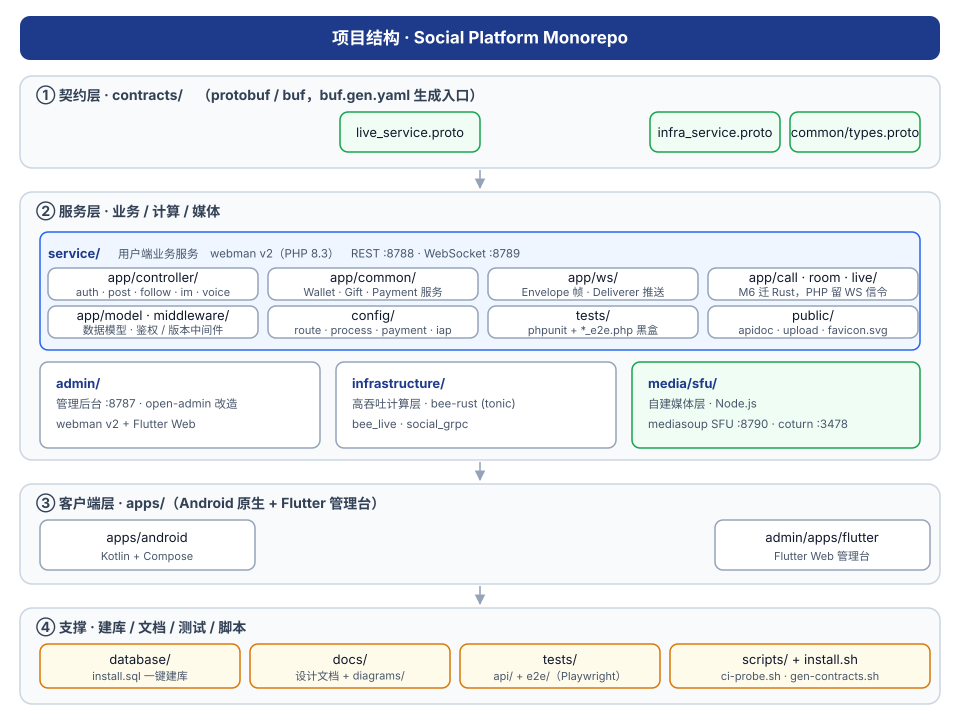

# Social Platform

**语言 / Languages:** [中文](README.md) · [English](docs/README.en.md)

多语言社交平台 monorepo：图文社区 + 即时消息 + 直播/语音 + 虚拟经济；PHP + Rust 双栈，Android 原生客户端 + Flutter 管理后台。

## 项目宠物


**Bub** · 消息气泡 —— 平台上最小的单位：图文、语音、直播弹幕、礼物打赏，最后都装进一只气泡里送出去；它会笑、会招手，左下那条尾巴指着消息要去的地方。

矢量源文件 [`docs/diagrams/mascot.svg`](docs/diagrams/mascot.svg)；简化标记 [`mascot-mark.svg`](docs/diagrams/mascot-mark.svg) 另作 `favicon.svg`，已嵌入 service / admin 站点与管理后台。


## 项目宠物表情形态 · Bub

-  **笑** `:emoji-smile:`
-  **欢乐** `:emoji-joy:`
-  **哭** `:emoji-cry:`
-  **沮丧** `:emoji-depressed:`
-  **惊恐** `:emoji-terrified:`
-  **愤怒** `:emoji-angry:`
-  **撒娇** `:emoji-coquettish:`
-  **卖萌** `:emoji-cute:`
-  **讨好** `:emoji-pleasing:`
-  **敲打** `:emoji-knocking:`
-  **捂脸** `:emoji-facepalm:`
-  **吐舌头** `:emoji-tongue:`

> 12 种彩色动态形态：笑 / 欢乐 / 哭 / 沮丧 / 惊恐 / 愤怒 / 撒娇 / 卖萌 / 讨好 / 敲打 / 捂脸 / 吐舌头。每个 SVG 自带表情、情绪特效与整体动效，并遵循 `prefers-reduced-motion`。

## 视觉资产授权 / Visual Assets License

本项目的项目宠物、图片、图标、表情（包括 `docs/pet-expressions/` 等目录下的
SVG / PNG）**不是开源资产**，版权归作者所有。未经书面许可不得复制、修改、再分发或
用于商业用途；商业使用需取得商业授权，联系 **erik@erik.xyz**。详见
[ASSETS-LICENSE.md](ASSETS-LICENSE.md)。

> 代码部分仍遵循仓库原有 `LICENSE`；第三方素材（如明确标注的 Go Gopher 等）仍遵循其原许可证。


## 项目介绍

- **原生客户端**：Android（Kotlin + Compose），另有 Flutter 管理后台
- **业务服务**：webman v2（PHP 8.3）承载 REST 与 WebSocket 双通道；直播 / 语聊房 / 1v1 通话状态机已迁 Rust（infrastructure/bee-rust），PHP 控制器经 gRPC 直连；API 通过 `X-Api-Version` 版本化（默认 v1，兼容 `/api/vX` 旧路径）
- **自建媒体层**：mediasoup SFU（本机 :8790）+ coturn TURN（REST 临时凭证），1v1 语音通话与语聊房（8 席：房主 + 7 麦位）媒体转发
- **状态分层**：MySQL 为业务事实，Redis 承载会话 / IM / 通话 / 房间实时状态
- **里程碑**：M0–M5 已交付（语音消息、1v1 通话、语聊房、直播）；M6 交付 live/voice 状态机 Rust 化迁移（PHP 经 gRPC 直连 Rust，熔断/降级/限流）；M6a 交付虚拟经济：钱包（余额/流水，MySQL 唯一事实源）、礼物打赏与主播分成、移动端 IAP 充值（App Store / Google Play / 华为）；M6b 交付支付渠道：充值入账骨架（微信/支付宝/Stripe 回调验签、服务端定价、幂等入账；提现与内部对账均已交付）；M6c 交付 CDN 存储：服务商管理端可配置（S3 兼容：AWS S3 / Cloudflare R2 / 阿里 OSS / 腾讯 COS / Backblaze B2），图片/语音/文件经对象存储 + CDN 分发；M6d 交付管理报表与起始页统计：报表模块（用户/支付/提现——日期筛选、汇总、趋势、分布、Excel 导出），起始页（仪表盘）新增平台统计卡片；v1.1 交付主键治理：bee_live 的 3 处 MySQL 写入改用 idgen_rs snowflake 显式主键，去除对 last_insert_id() 的依赖，对应表去 AUTO_INCREMENT；v1.1.1–v1.1.6 为文档 / CI / 稳定性修复，无新功能；v1.1.14 为安全 / 一致性修复：默认管理员与 JWT 密钥、IAP 全局收据闸门、钱包并发锁、IM 成员校验、微信回调解密、TURN 临时凭证、安装与迁移脚本；v1.1.15 为安全 / 稳定性加固：微信回调商户号与 AppID 校验、Stripe 未付款拦截、支付单歧义拒绝、服务端限流、禁用账号 30s 内生效、WS 登出踢线与入参校验、gRPC 超时、五组运营路由 RBAC、加密密钥统一并在 Rust 侧解密、Docker 图片水印依赖与测试补强

## 功能总览



图内功能随里程碑持续更新，最新纳入管理报表（用户 / 支付 / 提现）与起始页平台统计。

## 架构设计



## 业务核心流程



## 生命周期



## 功能设计



## 项目结构



| 目录 | 说明 | 技术 |
|------|------|------|
| contracts/ | gRPC 契约（proto，buf 生成入口） | protobuf / buf |
| service/ | 用户端业务服务（REST :8788 + WS :8789） | webman v2 (PHP 8.3) |
| admin/ | 管理后台（open-admin 改造） | webman v2 + Flutter |
| infrastructure/ | 高吞吐计算层（live/voice gRPC 服务） | bee-rust (tonic) |
| media/sfu/ | 自建媒体层（mediasoup SFU :8790 + coturn :3478） | Node.js（M4 启用） |
| apps/ | Android 原生客户端 | Kotlin + Compose |

service 内部结构：

```
service/
├── app/
│   ├── controller/   # REST 控制器（auth/post/follow/im/voice/wallet/gift/payment/...）
│   ├── common/        # WalletService（余额/流水/幂等记账）· GiftService（送礼/分成）· PaymentService（幂等建单/入账）· PaymentVerifier（三渠道验签）
│   ├── ws/           # WsServer · Envelope 帧协议 · Deliverer 推送 · ConnectionRegistry
│   ├── call/         # CallCenter：1v1 通话状态机（M6 迁 Rust，PHP 侧保留供 WS 信令）
│   ├── room/         # RoomCenter：语聊房（M6 迁 Rust，PHP 侧保留供 WS 信令）
│   ├── live/         # LiveCenter：直播房（M6 迁 Rust，PHP 侧保留供 WS 信令）
│   ├── model/        # 数据模型
│   ├── process/      # Http / WsServer 自定义进程
│   └── storage/      # 语音文件存储（m4a；M6 起由 Rust VoiceStorage 承载）
└── config/           # route.php（/api/v1 路由组）· process.php（:8788/:8789）· payment.php（渠道密钥/定价）
```

## 一键安装

前置要求：PHP ≥ 8.3（composer + ext-gd，图片水印需 DejaVu 字体，缺失时自动跳过水印）、MySQL、Redis、ffmpeg/ffprobe（Rust 语音转码；Docker 可选，用于媒体层）。

```bash
./install.sh
```

脚本会依次：对 `service/` 与 `admin/` 各执行一次 `composer install`；以 `database/install.sql` 建库（幂等，CREATE IF NOT EXISTS）；为两个服务生成 `.env`（随机 JWT / APP 密钥，不覆盖已存在文件），三端共享 `ENCRYPTABLE_KEY` 并生成 `infrastructure/.env`，自动升级旧版 `aes-128-ecb + 32 字节密钥` 配置；应用 `admin/database/migrations/2026_10_31_virtual_economy_permissions.sql` 权限迁移；首次导入时生成随机管理员密码并只打印一次，成功后写入 `admin/runtime/install.lock`；可选启动媒体层（`docker compose up -d` 起 media/sfu 与 coturn，`--skip-media` 跳过）；最后打印各服务启动命令与访问地址。

## 安装说明（手工安装）

1. 安装依赖：

```bash
cd service && composer install
cd admin && composer install
```

2. 建库：推荐直接用 `./install.sh` 完成；手工安装需按 `install.sh` 的 `sed` 分段命令，分别导入 `social` 与 `open_admin` 两个库（不要将整个 `install.sql` 导入单个库）。

3. 配置环境：推荐直接运行 `./install.sh` 生成 `.env` 与随机管理员密码；手动安装时创建 `service/.env` 与 `admin/.env`，至少填入 DB / Redis / JWT 密钥（生产环境务必使用随机密钥）。

4. 启动服务：

```bash
cd service && php start.php start -d   # HTTP :8788 · WS :8789
cd admin && php start.php start -d     # admin :8791
```

5. 启动媒体层（可选）：

```bash
cd media/sfu && docker compose up -d --build   # SFU :8790 · coturn :3478
```

## 使用说明

### 依赖

- PHP ≥ 8.3（composer）
- PHP ext-gd + DejaVu 字体（图片水印；缺失时自动跳过）
- ffmpeg / ffprobe（Rust 语音转码）
- Redis（默认 127.0.0.1:6379）
- Node.js ≥ 18（SFU 本地调试）
- Docker（SFU / coturn 容器）

### 启动业务服务

```bash
cd service
composer install
php start.php start -d      # HTTP :8788 · WS :8789
```

按需在 `service/.env` 配置 `REDIS`、`SFU_URL`（默认 127.0.0.1:8790）；启用微信支付时必填 `PAY_WECHAT_MCHID` / `PAY_WECHAT_APPID`，`ENCRYPTABLE_KEY` 需与 admin/infrastructure 保持一致。

### 启动媒体层

```bash
cd media/sfu
docker compose up -d --build   # SFU :8790（RTC UDP 10000-10200）· coturn :3478
```

### 客户端

| 端 | 打开 / 构建方式 | 平台要求 |
|----|----------------|----------|
| Android | `cd apps/android && ./gradlew assembleDebug` | Linux / macOS 可构建 |

### 测试

```bash
cd service && vendor/bin/phpunit              # PHPUnit：支付验签 / TURN 凭证 / 钱包账务
cd infrastructure && cargo test --workspace   # Rust：状态机 / 主键 / 加密解密
cd admin/apps/flutter && flutter test         # Flutter widget 测试
cd media/sfu && npm run smoke                 # SFU /signal 协议冒烟（需 Docker 容器或本地 node）
```

service 附带 PHPUnit（20 tests / 50 assertions，覆盖支付验签、TURN 凭证、钱包幂等/扣款）；CI 执行 service PHPUnit、admin 依赖安装、Rust 构建与测试；开源版不提供黑盒 E2E 脚本。

测试报告（2026-08-27 历史快照，中英双语）本地存储于 [`docs/test-reports/`](docs/test-reports/SUMMARY.md)；该快照对应的 PHP / API / E2E 脚本未随开源版提供，当前仅保留 `service/tests` 下的 PHPUnit。

## 文档

- 总体设计：`docs/superpowers/specs/2026-08-16-social-platform-design.md`
- M4 语音设计：`docs/superpowers/specs/2026-08-17-m4-voice-design.md`
- 实施计划：`docs/superpowers/plans/2026-08-17-m4-voice.md`
- M6d 报表 + 起始页统计设计：`docs/superpowers/specs/2026-08-31-m6d-reports-dashboard-design.md`
- M6d 实施计划：`docs/superpowers/plans/2026-08-31-m6d-reports-dashboard.md`

## 欢迎支持

如果这个项目对你有帮助，欢迎扫描二维码打赏支持，谢谢！

**微信支付**


**支付宝**


## 开源版 vs 商业版

商业版由作者单独提供。两版共用同一套 32 张表、Android 客户端、Flutter 管理后台与直播/语音/IM 核心；商业版补齐原生多端、全量搜索与完整 Rust 框架源码。

| 维度 | 开源版 | 商业版 |
|---|---|---|
| 源码文件（不含依赖/构建产物） | 316 | 404 |
| PHP 文件 / 控制器 | 248 / 40 | 277 / 42 |
| Rust 文件 / crate | 13 / 2 | 50 / 17 |
| 路由 | 120 | 123 |
| 数据表 | 32 | 32 |
| 客户端 | Android + Flutter 管理端 | Android + iOS + HarmonyOS 客户端 + Flutter 管理端 + HarmonyOS 管理端 |
| 搜索 | MySQL LIKE | Elasticsearch（帖子/用户搜索 + 同步队列 + webman-scout） |
| Rust 框架源码 | 仅 `social_grpc` + `bee_live` | 完整 bee-rust 17 crate（含 `bee_search` / `bee_graph` / `bee_orm` / `bee_router` / `bee_kv` / `bee_cache` 等） |

### 多维度对比

| 维度 | 开源版 | 商业版 |
|---|---|---|
| 功能覆盖 | 40 个控制器、32 张表、2 个 Rust crate；图文社区、IM、直播/语音/1v1、礼物钱包、Android + Flutter 管理端 | 42 个控制器、32 张表、17 个 Rust crate；在开源版全部功能上增加 iOS、HarmonyOS 客户端与 HarmonyOS 管理端、Elasticsearch、完整 bee-rust 框架 |
| 安全防护 | JWT + RBAC + 服务端限流 + SecurityFilter + 操作审计；微信回调商户号/AppID 校验、Stripe 未付款拦截；`config/{middleware,security,jwt,payment}.php` 与商业版逐文件一致 | 与开源版同一套中间件链和安全配置，未增加独立安全模块 |
| 性能与规模 | webman 多进程 HTTP + WebSocket + Rust gRPC + Redis + Media SFU/coturn | 架构与进程配置相同；额外引入 Elasticsearch 检索栈，客户端数量更多 |
| 数据与检索 | 32 张表；帖子/用户搜索走 MySQL LIKE | 32 张表（同构）；Elasticsearch 帖子/用户搜索 + 同步队列 + webman-scout |
| 测试与质量 | service PHPUnit（支付验签 / 钱包账务）+ Rust `cargo test --workspace` + Flutter widget test；CI：php-service / php-admin / rust-infra | 同一 CI；测试范围以商业交付为准 |
| 部署与运维 | `install.sh` 一键安装；media/sfu compose（sfu + coturn）；健康检查接口 | 安装与媒体栈相同；额外需要 iOS/HarmonyOS 构建工具链 |
| 多端与国际化 | Android 客户端 + Flutter 管理端；无独立 l10n 资源目录 | 增加 iOS、HarmonyOS 客户端与 HarmonyOS 管理端；国际化资源形态与开源版一致 |
| 扩展性与二次开发 | 2 个 Rust crate；contracts：common/infra/live；apidoc 约 17MB | 17 个 Rust crate（含 search/graph/orm/router/kv/cache）；contracts 增加 admin/user/search；三端 OpenAPI 配置 |
| 授权与商业支持 | 个人学习/研究；商业使用需书面授权 | 同一条款；商业授权、交付与支持联系 erik@erik.xyz |
| 适用场景 | 个人学习、研究、小规模自建核心社区 | 商业部署、多端交付、需要搜索与完整 Rust 框架源码的团队 |

**English — multi-dimensional comparison:**

| Dimension | Open Source | Commercial |
|---|---|---|
| Feature scope | 40 controllers, 32 tables, 2 Rust crates; feed, IM, live/voice/1v1, gifts/wallet, Android + Flutter admin | 42 controllers, 32 tables, 17 Rust crates; all open features plus iOS/HarmonyOS clients, HarmonyOS admin, Elasticsearch, full bee-rust framework |
| Security | JWT + RBAC + rate limiting + SecurityFilter + audit; `config/{middleware,security,jwt}.php` identical to commercial | Same middleware chain and security config; no separate security module added |
| Performance & scale | webman multi-process HTTP + WebSocket + Rust gRPC + Redis + Media SFU/coturn | Same architecture and process config; adds an Elasticsearch stack and more clients |
| Data & search | 32 tables; post/user search via MySQL LIKE | Same 32-table schema; Elasticsearch post/user search + sync queue + webman-scout |
| Tests & quality | Rust `cargo test --workspace` + Flutter widget test; CI: php-service / php-admin / rust-infra | Same CI; test scope follows the commercial delivery |
| Deployment & ops | `install.sh`; media/sfu compose (sfu + coturn); health endpoints | Same install/media stack; extra iOS/HarmonyOS build toolchains required |
| Clients & i18n | Android client + Flutter admin; no standalone l10n resource tree | Adds iOS/HarmonyOS clients and HarmonyOS admin; i18n resource shape matches open |
| Extensibility | 2 Rust crates; contracts common/infra/live; ~17MB apidoc | 17 Rust crates (search/graph/orm/router/kv/cache); contracts add admin/user/search; OpenAPI configs for three clients |
| License & support | Personal study/research; commercial use requires written authorization | Same terms; commercial licensing, delivery and support: erik@erik.xyz |
| Best for | Personal learning, research, small self-hosted community | Commercial deployment, multi-client delivery, teams needing search and the full Rust framework source |

**商业版独有能力：**

- iOS 原生客户端（5 个 Swift 源文件）与 HarmonyOS 原生客户端（5 个 ArkTS 页面）。
- HarmonyOS 管理端（12 个 ArkTS 文件：登录/仪表盘/用户/详情/我的）。
- Elasticsearch 全文搜索：`/api/v1/search/posts|users`、搜索同步队列、webman-scout 插件。
- 完整 bee-rust 框架源码，便于二次开发与私有化交付。
- 保留 demo 首页、`VoiceStorage` 与 Ping 契约等演示/脚手架文件（开源版已清理）。

**开源版保留：** 图文社区、IM、直播/语音/1v1、礼物与钱包、Android 客户端、Flutter 管理后台、32 张表与核心 API。

**商业版授权与交付条款请联系：erik@erik.xyz**

**English:** The commercial edition (available separately) shares the same 32-table schema, Android client, Flutter admin and live/voice/IM core, and adds native iOS/HarmonyOS clients, a HarmonyOS admin, Elasticsearch search (posts/users + sync queue + webman-scout), and the full 17-crate bee-rust framework source. The open edition keeps the core platform with MySQL LIKE search plus the Android and Flutter admin clients. For commercial licensing and delivery terms, contact erik@erik.xyz.

## 项目授权 / Project License

Copyright (c) 2026 erik erik@erik.xyz — https://erik.xyz

- 本项目仅供个人学习、研究使用。
- 未经作者书面授权，禁止任何形式的商业使用（包括但不限于商业部署、付费服务、二次销售、SaaS 运营及以本项目为基础提供商业服务）。
- 商业授权请联系 **erik@erik.xyz**。
- 未经授权的商业使用，作者将在全球范围内依法追究法律责任，并保留终身追责的权利。
- 第三方组件仍遵循其各自原有的许可证；视觉资产适用仓库内的 ASSETS-LICENSE.md（如适用）。

**English:** This project is provided for personal study and research only. Commercial use of any kind requires prior written authorization from the author (erik@erik.xyz). Unauthorized commercial use will be pursued for legal liability worldwide, and the author reserves the right to pursue such liability for life. Third-party components remain under their original licenses; visual assets are governed by ASSETS-LICENSE.md where applicable.
