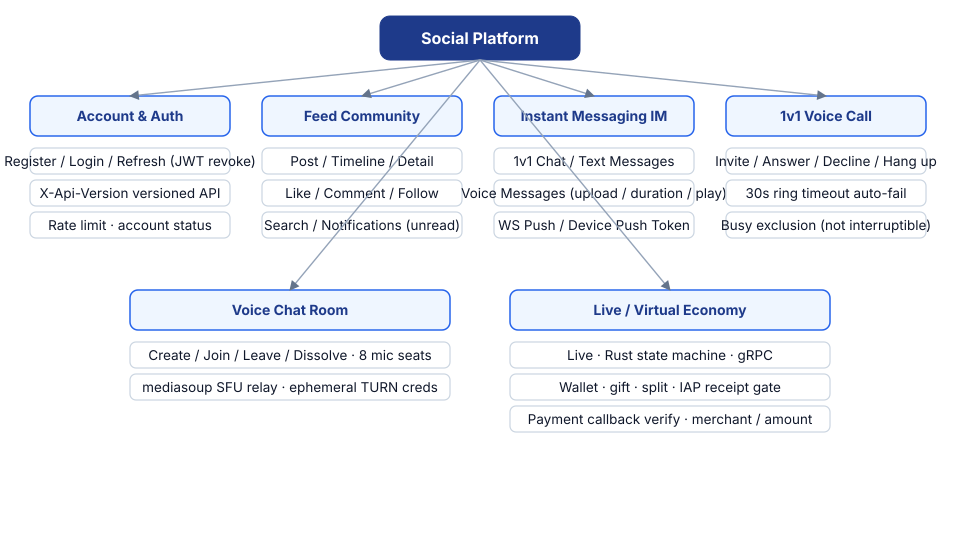
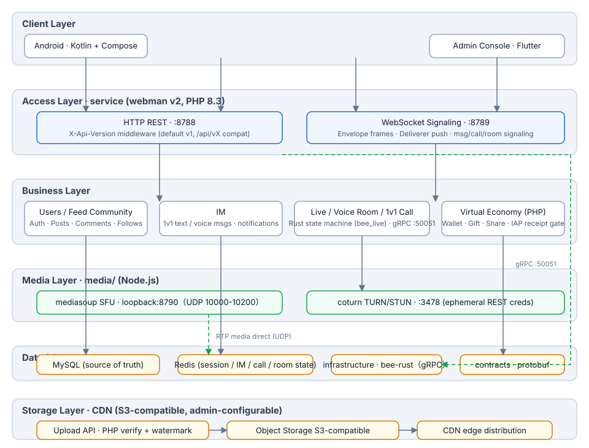
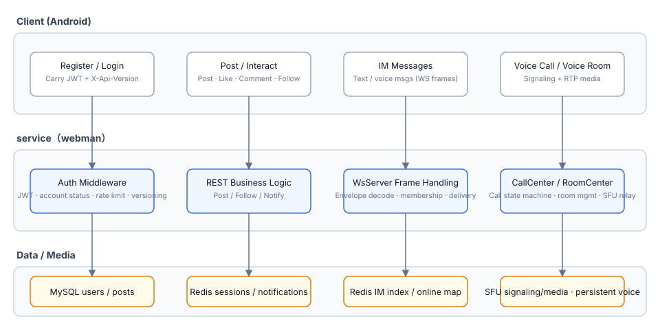
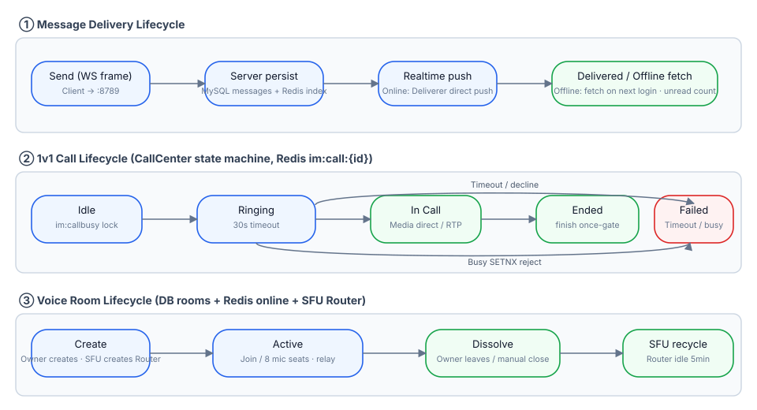
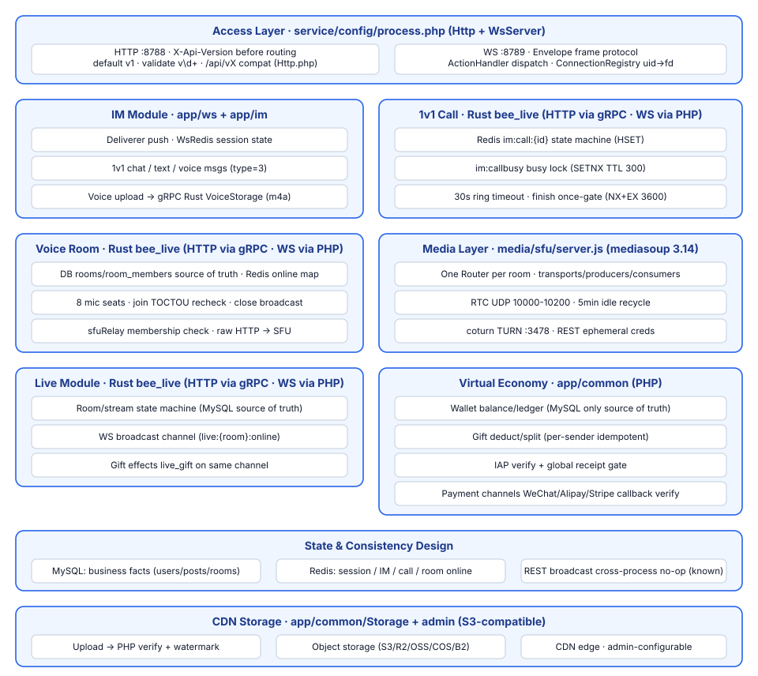
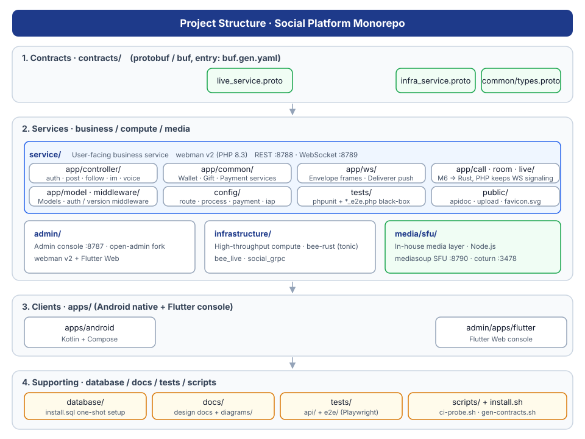

# Social Platform

**语言 / Languages:** [中文](../README.md) · [English](README.en.md)

Multilingual social platform monorepo: image/text community + instant messaging + live/voice + virtual economy; a PHP + Rust stack with an Android native client and a Flutter admin console.

## Project Mascot


**Bub** · a message bubble. The smallest unit of the platform: posts, voice notes, live danmaku and gifts all leave inside one bubble; it smiles, it waves, and the tail at its lower left points where the message is headed.

Vector source: [`diagrams/mascot.svg`](diagrams/mascot.svg); the simplified mark [`mascot-mark.svg`](diagrams/mascot-mark.svg) also ships as `favicon.svg` on the service / admin sites and in the admin console.

## Mascot Expressions · Bub

-  **Smile** `:emoji-smile:`
-  **Joy** `:emoji-joy:`
-  **Cry** `:emoji-cry:`
-  **Depressed** `:emoji-depressed:`
-  **Terrified** `:emoji-terrified:`
-  **Angry** `:emoji-angry:`
-  **Coquettish** `:emoji-coquettish:`
-  **Cute** `:emoji-cute:`
-  **Pleasing** `:emoji-pleasing:`
-  **Knocking** `:emoji-knocking:`
-  **Facepalm** `:emoji-facepalm:`
-  **Tongue** `:emoji-tongue:`

> 12 colorful animated expressions: Smile / Joy / Cry / Depressed / Terrified / Angry / Coquettish / Cute / Pleasing / Knocking / Facepalm / Tongue. Each SVG carries its own expression, emotional effects and overall animation, and honors `prefers-reduced-motion`.

## Visual Assets License

The project mascot, images, icons and expressions (including the SVG / PNG files under `pet-expressions/` and similar directories) are **not open-source assets** and remain the copyright of the author. They may not be copied, modified, redistributed or used commercially without written permission; commercial use requires a commercial license — contact **erik@erik.xyz**. See [ASSETS-LICENSE.md](../ASSETS-LICENSE.md) for details.

> Code remains under the repository's `LICENSE`; third-party assets remain under their own licenses where explicitly marked.

## Introduction

- **Native client**: Android (Kotlin + Compose), plus a Flutter admin console
- **Business services**: webman v2 (PHP 8.3) serving both REST and WebSocket channels; live/voice-call state machines migrated to Rust (infrastructure/bee-rust); PHP controllers connect via gRPC; the API is versioned via `X-Api-Version` (default v1, compatible with legacy `/api/vX` paths)
- **In-house media layer**: mediasoup SFU (loopback :8790) + coturn TURN (REST ephemeral credentials) for media forwarding in 1v1 voice calls and voice chat rooms (8 seats: host + 7 mics)
- **State layering**: MySQL as the source of truth for business data, Redis for real-time session / IM / call / room state
- **Milestones**: M0–M5 delivered (voice messages, 1v1 calls, voice chat rooms, live streaming); M6 delivers the Rust migration of live/voice state machines (PHP calls Rust directly over gRPC; circuit breaker / degradation / rate limiting); M6a delivers the virtual economy: wallet (balance/ledger, MySQL as single source of truth), gift tipping with streamer share, and mobile IAP top-up (App Store / Google Play / Huawei); M6b delivers payment channels: top-up crediting skeleton (WeChat/Alipay/Stripe callback signature verification, server-side pricing, idempotent crediting; withdrawals and reconciliation delivered); M6c delivers CDN storage: providers configurable from admin panel (S3-compatible: AWS S3 / Cloudflare R2 / Aliyun OSS / Tencent COS / Backblaze B2), images/voice/files served via object storage + CDN; M6d delivers admin reports and dashboard statistics: report module (users/payments/withdrawals — date filtering, totals, trends, distributions, Excel export) plus platform-statistics cards on the home page; v1.1 delivers primary-key governance: the three MySQL writes in bee_live now pass explicit idgen_rs snowflake IDs, removing the dependency on last_insert_id(); the corresponding tables drop AUTO_INCREMENT; v1.1.1–v1.1.6 are documentation / CI / stability fixes with no new features; v1.1.14 delivers security / consistency fixes: default admin and JWT secrets, global IAP receipt gate, wallet concurrency locks, IM membership checks, WeChat callback decryption, ephemeral TURN credentials, and install/migration scripts

## Feature Overview



## Architecture



## Core Business Flows



## Lifecycle



## Module Design



## Project Structure



| Directory | Description | Tech |
|------|------|------|
| contracts/ | gRPC contracts (proto, buf generation entry) | protobuf / buf |
| service/ | User-facing business service (REST :8788 + WS :8789) | webman v2 (PHP 8.3) |
| admin/ | Admin console (built on open-admin) | webman v2 + Flutter |
| infrastructure/ | High-throughput compute layer (live/voice gRPC services) | bee-rust (tonic) |
| media/sfu/ | In-house media layer (mediasoup SFU :8790 + coturn :3478) | Node.js (enabled in M4) |
| apps/ | Android native client | Kotlin + Compose |

Internal structure of service:

```
service/
├── app/
│   ├── controller/   # REST controllers (auth/post/follow/im/voice/wallet/gift/payment/...)
│   ├── common/        # WalletService (balance/ledger/idempotent) · GiftService (gift/split) · PaymentService (idempotent order/credit) · PaymentVerifier (3-channel verify)
│   ├── ws/           # WsServer · Envelope frame protocol · Deliverer push · ConnectionRegistry
│   ├── call/         # CallCenter: 1v1 call state machine (M6 migrated to Rust; PHP side kept for WS signaling)
│   ├── room/         # RoomCenter: voice chat rooms (M6 migrated to Rust; PHP side kept for WS signaling)
│   ├── live/         # LiveCenter: live rooms (M6 migrated to Rust; PHP side kept for WS signaling)
│   ├── model/        # Data models
│   ├── process/      # Custom Http / WsServer processes
│   └── storage/      # Voice file storage (m4a; carried by Rust VoiceStorage since M6)
└── config/           # route.php (/api/v1 route group) · process.php (:8788/:8789) · payment.php (channel keys/pricing)
```

## One-Click Install

Prerequisites: PHP ≥ 8.3 (composer), MySQL, Redis (Docker optional, for the media layer).

```bash
./install.sh
```

The script: runs `composer install` once for each of `service/` and `admin/`; creates the database from `database/install.sql` (idempotent, CREATE IF NOT EXISTS); generates `.env` for both services (random JWT / APP keys, never overwrites existing files); on first import, generates a random admin password and prints it once, then writes `admin/runtime/install.lock`; optionally starts the media layer (`docker compose up -d` for media/sfu and coturn, `--skip-media` to skip); finally prints the commands to start each service and the access URLs.

## Manual Install

1. Install dependencies:

```bash
cd service && composer install
cd admin && composer install
```

2. Create the database: preferably use `./install.sh`; for a manual install, import the `social` and `open_admin` segments separately using the `sed` commands in `install.sh` (do not import the whole file into one database).

3. Configure environment: preferably run `./install.sh` to generate `.env` and the random admin password; for a manual install, create `service/.env` and `admin/.env` and fill in at least the DB / Redis / JWT keys (always use random keys in production).

4. Start the services:

```bash
cd service && php start.php start -d   # HTTP :8788 · WS :8789
cd admin && php start.php start -d     # admin :8791
```

5. Start the media layer (optional):

```bash
cd media/sfu && docker compose up -d --build   # SFU :8790 · coturn :3478
```

## Getting Started

### Dependencies

- PHP ≥ 8.3 (composer)
- Redis (default 127.0.0.1:6379)
- Node.js ≥ 18 (local SFU debugging)
- Docker (SFU / coturn containers)

### Start the business service

```bash
cd service
composer install
php start.php start -d      # HTTP :8788 · WS :8789
```

Configure `REDIS` and `SFU_URL` (default 127.0.0.1:8790) in `service/.env` as needed.

### Start the media layer

```bash
cd media/sfu
docker compose up -d --build   # SFU :8790 (RTC UDP 10000-10200) · coturn :3478
```

### Clients

| Platform | How to open / build | Platform requirements |
|----|----------------|----------|
| Android | `cd apps/android && ./gradlew assembleDebug` | Buildable on Linux / macOS |

### Tests

```bash
cd infrastructure && cargo test --workspace   # Rust unit tests (state machine / ID generation)
cd admin/apps/flutter && flutter test         # Flutter widget tests
cd media/sfu && npm run smoke                 # SFU /signal protocol smoke test (requires Docker container or local node)
```

The open-source edition does not include PHP unit tests or black-box E2E scripts; CI only checks dependency installation for PHP and runs the Rust workspace tests.

## Welcome Support

If this project helps you, scan the QR code to support us, thank you!

**WeChat Pay**


**Alipay**


## Documentation

- Overall design: `superpowers/specs/2026-08-16-social-platform-design.md`
- M4 voice design: `superpowers/specs/2026-08-17-m4-voice-design.md`
- Implementation plan: `superpowers/plans/2026-08-17-m4-voice.md`
